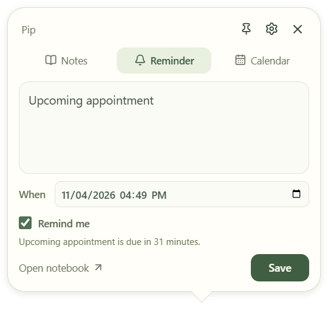

# Research Buddy 🦊

**Pip is a little fox who lives on your desktop.** This tiny pixel fox strolls, blinks, waves, stretches awake, tells gentle jokes, and offers a paw when you need one. Click the fox for your notes, research, and reminders.

**Status: early Windows build · animals and automatic updates 0.9.0.** Notes work locally without an account. Optional Google Calendar sync needs an app registration and Google sign-in; hosted AI remains future work.



## Try it

[Download Pip for Windows](https://github.com/marcusdiccox/research-buddy/releases/latest). Open **Pip-Setup-0.9.0.exe** and follow the installer. It adds desktop and Start menu shortcuts and enables **Start with Windows** on first install. Settings lets you turn automatic startup off; upgrades preserve that choice. No terminal is needed.

Install 0.9.0 once to enable automatic updates. Installed Windows builds check this repository's stable GitHub releases after startup and every six hours, download updates quietly and install when you quit Pip. The small refresh button in Settings checks manually and shows update status. Shutdown/log-off defers installation. Development, unpacked and test builds do not auto-update. Source commits alone do not trigger downloads.

After installation, open **Research Buddy** from the desktop or Start menu. Quitting Pip ends the current session; automatic startup opens it again when you next sign in to Windows. Uninstall removes Pip’s own startup entry.

Development builds are also available under [Windows builds](https://github.com/marcusdiccox/research-buddy/actions/workflows/ci.yml). A standard `npm run pack` creates `release/win-unpacked/Research Buddy.exe`; `npm run make` creates the installer in `release/`. Unpacked builds do not register themselves for automatic startup.

1. Click Pip for an editable speech bubble with **Notes**, **Reminder**, and **Calendar** tabs. Pip stays still while you write. **Saved** opens searchable notes and reminders, with groups and recoverable Trash. **Open notebook** expands the current note/reminder into the larger editor; its **All research tools** option opens the research features below. The pin keeps your bubble visible when you switch apps; otherwise it tucks away without losing the draft. The gear opens minimal fox settings.
2. Open a note and choose **Quick summary**. Click **See source** to check any passage.
3. Use **Ask my notes** to find relevant passages across the current workspace.
4. Add a reminder, or record your thinking in **Thesis journal**.
5. Press **Ctrl + Alt + P** to show or hide Pip. Restoring Pip gives it a slow walk-on entrance; reduced motion skips it. Ctrl+Alt+Delete is reserved by Windows. The tray is always a fallback.

The early build is unsigned. Windows may show its usual prompt for an unrecognized app. Supported target: Windows 11 x64; this build was exercised on the development computer, not a separate clean machine.

## Make the fox your own

Use the small notepad’s Settings button, or right-click Pip → **Fox settings**, to choose:

- **Animal:** Fox, Red panda or Otter.
- **Appearance:** Natural, Arctic or Midnight for every animal. Switching animals keeps the color.
- **Bottom edge**, **whole screen**, or **stay where I put Pip**.
- **Cute & wholesome**, **dad jokes & puns**, or **nerdy little jokes**.
- Reduced motion and your preferred show/hide shortcut.

Pip is smaller now: an 80px control, random 25–180px trips at 12–24px/s, with 3½–7s rests. It chooses a fresh direction each trip and turns away near the screen edges. Hover stops it so you can click. The background is transparent and unused space passes clicks through. Small joke bubbles appear automatically while Pip is awake. Its 97 lines are shuffled within each theme without repeats until the pool is exhausted. Pip curls up after two minutes without fox interaction; hovering or clicking wakes it with a stretch.

The red panda hugs its ringed tail. The otter washes its cheeks and sometimes takes a slower 12–18px/s paddle, with separate transitions into and out of swimming. Right-click for **Tail hug**, **Float a little** or **Say hello**. Each animal has its own greeting and additional joke lines. Both new animals have generated four-frame movement and sit/sleep/wake transition sheets; all colors and reduced motion use the same renderer.

## Routines

- **Repeating reminders:** None, Daily, Weekdays, Weekly or Monthly. Mark done advances the same reminder to its next future local occurrence, retaining the five warning checkpoints. Monthly dates clamp short months and retain the original day. A nonexistent DST time is skipped. Google sync updates the same event to its next occurrence; it does not create a Google recurring series.
- **Quiet focus:** start 15, 25 or 45 minutes from Notes or the notebook. Pip settles and pauses casual speech; event reminders continue. Stop anytime. Quitting ends the session.
- **Natural dates:** open the date picker and type “tomorrow at 3pm”, “next Friday at 09:00” or “in 30 minutes”. Preview, Use date, then Done. Explicit am/pm or 24-hour time avoids ambiguity. Parsing stays local; unsupported input gives feedback.

## What works

- **Notes and workspaces:** create a workspace for a company, class, or project; paste notes or import UTF-8 `.txt` and `.md` files. Files are previewed before saving.
- **Saved library:** search note text and reminders, filter by type/group, select several items to group together, and move items to Trash or restore them. Groups are separate from research workspaces. Trashing a reminder stops local alerts and queued uploads; Google events already synced remain in Google. Historical research citations retain their source revisions.
- **Quick summary:** selects important passages locally, preserving exact source quotes. It is extractive passage selection, not a hosted AI response.
- **Ask my notes:** finds matching passages inside the selected workspace and says when it finds no evidence. It does not invent an answer.
- **Saved evidence:** editing a note preserves its earlier versions. Old summaries are marked as needing a fresh look when their source changes.
- **Thesis journal:** record a thesis, counterarguments, and conditions that would change your mind. Revisions preserve all fields and attached evidence.
- **Reminders:** save a date/time and duration, with a single **Remind me** checkbox. A small calendar and separate time field support mouse or keyboard entry. Pip warns at **1 day, 6 hours, 2 hours, 1 hour, and 30 minutes** before the event. Editor alerts and optional Windows notifications also work while the app runs. Missed warnings collapse to one catch-up; successful checkpoints persist across restart. You can snooze for 15 minutes, complete, and reopen.
- **Connected Calendar:** sign in from the compact Calendar tab, then mark reminders for automatic creation/update in your primary Google calendar while Pip runs. Pending changes retry. This is one-way; Google-side edits are not imported. [Setup and permissions](docs/google-calendar-setup.md). Manual event drafts and `.ics` export remain available.
- **Pip and the tray:** drag the fox to move it. Click for the notepad; right-click for tools/settings. Hide/restore with your shortcut or tray. Closing a window keeps Pip running; **Quit Research Buddy** stops it.
- **Portable research:** export readable Markdown with sources, summaries, journal history, evidence links, and workspace reminders.

## A few practical details

Reminders cannot wake a powered-off computer and stop after you quit the app. Overdue reminders remain visible when you return. Windows notification settings and Focus Assist can affect whether a toast appears.

All note processing in this build happens on your device. No research is sent to an AI service. Clicking the Google Calendar action opens Google with the reminder details you chose to include.

Data is saved in an ordinary, unencrypted SQLite file in Electron's user-data directory, normally `%APPDATA%/Research Buddy/research.sqlite`. Exported Markdown is also plaintext. Keep sensitive research on a trusted computer.

**Automatic local backups:** Pip takes a verified notebook snapshot on startup and checks every 30 minutes while running, at most once per UTC date. The latest seven daily snapshots live in `%APPDATA%/Research Buddy/backups/`. Each includes notes, reminders, settings and notebook history. A failed backup leaves previous snapshots intact and does not stop Pip opening. Snapshots are unencrypted, stay on this computer and can be up to a day old while Pip runs; a closed app cannot create backups. A restore screen and protection against disk loss are future work. Available in the 0.8.1 installer and later builds.

Imports support up to 2 MiB and 100,000 Unicode code points. Publication dates are optional and separate from save dates. The app does not fetch source URLs or provide live prices. PDF/OCR, permanent erasure/workspace deletion, cloud sync and a backup restore screen are not included yet.

## Develop

Use Node.js 24+ and npm on Windows.

```powershell
npm ci
npm start
```

Useful commands:

```powershell
npm run typecheck
npm test
npm run build
npm run test:e2e
npm run pack
npm run make
```

`test:e2e` uses the compiled app, so run `build` first. `pack` creates an unpacked executable; `make` creates an NSIS installer. To run the same desktop tests against an unpacked build, set `BUDDY_EXECUTABLE` to its absolute `.exe` path before `npm run test:e2e`.

Packaging never publishes by itself. The Windows workflow uploads the installer, blockmap and `latest.yml` as build artifacts. Pushing a `v*` tag that matches `package.json` publishes them together only after the Windows checks pass; an existing release is left untouched. Add release notes in `docs/releases/<tag>.md`. Update versions monotonically; don't overwrite assets clients may already have downloaded. See [electron-builder's update guide](https://www.electron.build/v26/docs/features/auto-update/).

The renderer uses React and TypeScript, with an isolated preload bridge. Electron owns SQLite, file dialogs, native notifications, and fixed-host calendar actions. Modern Electron's built-in SQLite avoids a separately rebuilt native driver. Tests use temporary databases and fictional notes.

## Roadmap and epic

[Follow the GitHub epic and its ten child issues](https://github.com/marcusdiccox/research-buddy/issues/1).

- [Epic and ten child issue specifications](docs/epics/research-buddy-v0.1.md)
- [Fox companion design](docs/superpowers/specs/2026-11-04-fox-companion-design.md)
- [Original product design](docs/superpowers/specs/2026-11-03-research-buddy-design.md)
- [Original implementation plan](docs/superpowers/plans/2026-11-03-research-buddy.md)
- [Calendar and saved library verification](docs/calendar-library-verification.md)
- [Research-only future ideas](docs/ideas/2026-11-04-helpful-next-steps.md)
- [Reminder update verification](docs/reminders-update-verification.md)
- [Windows startup verification](docs/startup-verification.md)
- [Development decisions and verification](docs/development-progress.md)

The original epic includes optional hosted AI and a broader release checklist. The current local build implements the usable offline foundation; it does not claim every epic item is finished. A project license has not been selected.
