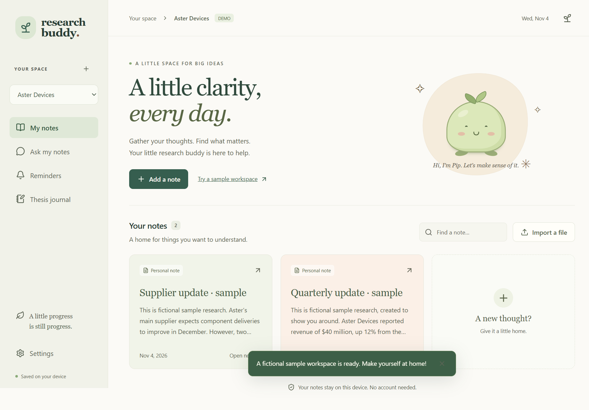

# Research Buddy 🌱

A cozy desktop notebook with a little companion named **Pip**. Save your research, find the important passages, keep track of your thinking, and let Pip remember the little things.

**Status: working early Windows build.** The first version works locally without an account, API key, or subscription. Hosted AI and calendar account sync are future work.



## Try it

On the computer where this project was built, open **`release/win-unpacked/Research Buddy.exe`**. The Windows installer is generated in `release/` by `npm run make`.

1. Click **Try a sample workspace** to look around using fictional research, or **Add a note** to start with your own text.
2. Open a note and choose **Quick summary**. Click **See source** to check any passage.
3. Use **Ask my notes** to find relevant passages across the current workspace.
4. Add a reminder, or record your thinking in **Thesis journal**.
5. Click Pip on your desktop whenever you want to return.

The early build is unsigned. Windows may show its usual prompt for an unrecognized app. Supported target: Windows 11 x64; this build was exercised on the development computer, not a separate clean machine.

## What works

- **Notes and workspaces:** create a workspace for a company, class, or project; paste notes or import UTF-8 `.txt` and `.md` files. Files are previewed before saving.
- **Quick summary:** selects important passages locally, preserving exact source quotes. It is extractive passage selection, not a hosted AI response.
- **Ask my notes:** finds matching passages inside the selected workspace and says when it finds no evidence. It does not invent an answer.
- **Saved evidence:** editing a note preserves its earlier versions. Old summaries are marked as needing a fresh look when their source changes.
- **Thesis journal:** record a thesis, counterarguments, and conditions that would change your mind. Revisions preserve all fields and attached evidence.
- **Reminders:** save a date/time and duration, receive Windows notifications while the app is running, snooze for 15 minutes, complete, and reopen. Failed native delivery remains retryable with backoff.
- **Calendar actions:** **Add to Google Calendar** opens a prefilled event in your browser; review it and click **Save** there. **Calendar file** saves an `.ics` event for other calendar apps. This is not account sync or automatic insertion.
- **Pip and the tray:** move the companion by dragging the label above its head. Hide or restore it in Settings. Closing the notebook leaves Research Buddy in the tray; use **Quit Research Buddy** to stop it.
- **Portable research:** export readable Markdown with sources, summaries, journal history, evidence links, and workspace reminders.

## A few practical details

Reminders cannot wake a powered-off computer and stop after you quit the app. Overdue reminders remain visible when you return. Windows notification settings and Focus Assist can affect whether a toast appears.

All note processing in this build happens on your device. No research is sent to an AI service. Clicking the Google Calendar action opens Google with the reminder details you chose to include.

Data is saved in an ordinary, unencrypted SQLite file in Electron's user-data directory, normally `%APPDATA%/Research Buddy/research.sqlite`. Exported Markdown is also plaintext. Keep sensitive research on a trusted computer.

Imports support up to 2 MiB and 100,000 Unicode code points. Publication dates are optional and separate from save dates. The app does not fetch source URLs or provide live prices. PDF/OCR, note/workspace deletion, cloud sync, recurring reminders, and full backup/restore are not included yet.

## Develop

Use Node.js 24+ and npm on Windows.

```powershell
npm ci
npm start
```

Useful commands:

```powershell
npm run typecheck
npm test
npm run build
npm run test:e2e
npm run pack
npm run make
```

`test:e2e` uses the compiled app, so run `build` first. `pack` creates an unpacked executable; `make` creates an NSIS installer. To run the same desktop tests against an unpacked build, set `BUDDY_EXECUTABLE` to its absolute `.exe` path before `npm run test:e2e`.

The renderer uses React and TypeScript, with an isolated preload bridge. Electron owns SQLite, file dialogs, native notifications, and fixed-host calendar actions. Modern Electron's built-in SQLite avoids a separately rebuilt native driver. Tests use temporary databases and fictional notes.

## Roadmap and epic

- [Epic and ten child issue specifications](docs/epics/research-buddy-v0.1.md)
- [Product design](docs/superpowers/specs/2026-11-03-research-buddy-design.md)
- [Original implementation plan](docs/superpowers/plans/2026-11-03-research-buddy.md)
- [Development decisions and verification](docs/development-progress.md)

The original epic includes optional hosted AI and a broader release checklist. The current local build implements the usable offline foundation; it does not claim every epic item is finished. A project license has not been selected. Choose one before publishing a software release.
