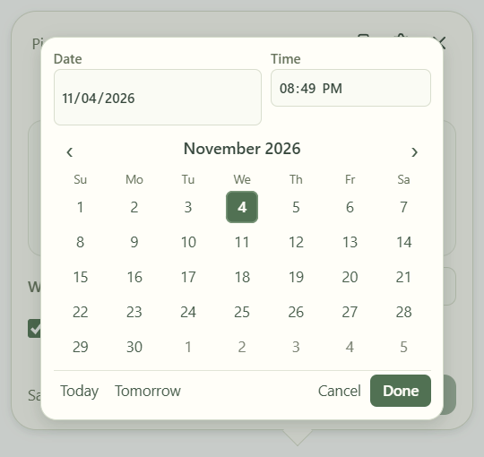
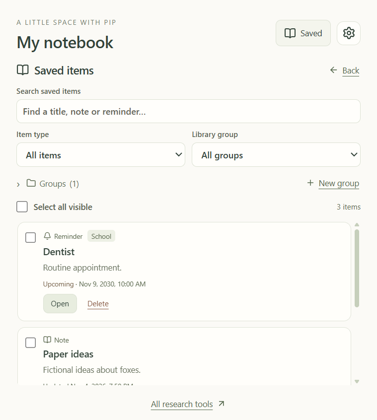

# Calendar and saved library update 0.6

The user confirmed a shared library for notes and reminders. A compact month/time dialog replaces the native date-time picker across the writing bubble, notebook and advanced reminder form. Direct Date/Time fields, keyboard calendar navigation, Today/Tomorrow, Done/Cancel and return focus work without enlarging the native bubble.

Saved opens search, type/group filters, previews, readable status and selectable notes/reminders. Groups support creation, rename, removal and bulk assignment without moving research workspaces or changing note revisions. Delete moves items to recoverable local Trash. It stops local reminder alerts and prevents later queued uploads; Google events already uploaded remain in Google. Current note lists/search exclude Trash. Earlier research citations retain source revisions, including in historical dossier evidence.

Independent review reproduced stale bubble identities after Trash, including when both item kinds had been saved. Both saved IDs now reconcile independently against active items. Clean deleted text clears; unsaved text remains as a new unbound draft. Tests observed both orderings failing before the fix and passing after it. Additional regressions cover queued local alerts, queued calendar uploads, restore acknowledgements/opt-out, FTS restoration and cited-history exports.

111 backend tests and TypeScript/build checks pass. The initial full desktop run passed all functional assertions but found low-contrast library labels. Those labels were darkened; all eight calendar/library journeys then passed, including keyboard, contrast, viewport fitting, grouping, Trash/restore and draft preservation. The full packaged suite is recorded below after delivery. Automated checks are not a complete assistive-technology audit.

Windows test cleanup has a bounded exception for a lingering inspector wrapper only after an unprevented will-quit marker (after app database cleanup) and zero remaining Electron windows. An app that fails to acknowledge graceful quit still fails the test. This addresses verification stalls without changing production shutdown behavior.

Additional researched ideas are documented in [Helpful next steps](ideas/2026-11-04-helpful-next-steps.md). None of those proposals is implemented here. Existing unsigned-build and live Google setup limitations remain.

Installer: `release-pip-library/Research Buddy Setup 0.6.0.exe` (128,210,310 bytes). SHA-256: `350D0A0199A9F43A2717F68B5447520EFDBB53B07D1AD2D2D209BEFA792E33A3`. The package was assembled with inputs held unchanged, and all 4,744 archive files passed SHA-256 integrity checks.

All 39 desktop journeys passed against the packaged executable, including both new screens and the existing research/fox/reminder workflows.

The real saved notebook was backed up locally before normal launch. Version 0.6 was launched on the desktop, the writing bubble and Saved entry point were observed, and existing saved note/project/journal contents matched the pre-update backup. No real items were deleted or grouped during testing.
